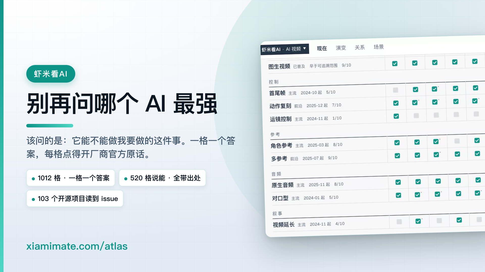

# 虾米看 AI · AI 能力地图

**从具体任务出发，看清 AI 能做什么，以及依据在哪里。**

把模型、能力、适用场景、版本与信息来源放在一张可以逐项查看的地图上。无论你在选工具、做产品，还是跟进技术变化，都可以沿着能力找到原始依据。

[在线浏览](https://cherler.github.io/xiamimate-ai-atlas/) · [视频演示](https://cherler.github.io/xiamimate-ai-atlas/promo/) · [更新记录](https://cherler.github.io/xiamimate-ai-atlas/changes/) · [文档导航](docs/README.md)

## 33 秒看一遍：别再问哪个 AI 最强

[](https://cherler.github.io/xiamimate-ai-atlas/promo/)

[▶ 播放宣传视频](https://cherler.github.io/xiamimate-ai-atlas/promo/) · 33 秒 · 1080p · 点击封面播放

视频中的统计和页面对应录制时版本；最新数据、版本与访问入口以当前站点为准。

## 从能力到选择

| 想知道什么 | 在这里怎么看 |
| --- | --- |
| 某个模型能不能完成我的任务？ | 在能力矩阵里逐项查看支持情况与限制 |
| 视频、图像、声音等方向有哪些选择？ | 按九个能力方向浏览与比较 |
| 这个判断从哪里来？ | 查看引用、来源快照、核验日期与适用版本 |
| 新一代模型改变了什么？ | 查看版本信息、演变关系与更新记录 |
| 信息过期或有误，怎样修订？ | 通过审阅工具维护数据，保留修改依据 |

九个方向：**视频、图像、文本、声音、3D、数字人、具身智能、世界模型、科学计算**。

## 建议这样开始

1. 先选能力方向，找到你要完成的具体任务。
2. 比较相关模型的能力格，打开来源与限制说明。
3. 确认核验日期和版本，再决定是否适合自己的场景。

适合 AI 产品选型、创作工具比较、技术研究与持续学习。能力格是基于来源的整理，不代替对你实际任务的测试。

## 这个项目包含什么

- **完整浏览站点**：模型、能力、场景、关系和更新记录。
- **可追溯数据**：模型与能力信息以 `data/atlas.json` 为真源，变更记录在 `data/changes.json`。
- **维护工作台**：来源核查、版本跟踪、引文回查与审阅工具。
- **静态发布流程**：生成图表与分享图，检查数据和链接，再发布 GitHub Pages。

Pages 可独立使用；采集、监控和本地审阅台按需手动开启，不会为了浏览页面自动运行。

## 本地运行

需要 Node.js 22 和 npm。

```bash
git clone https://github.com/cherler/xiamimate-ai-atlas.git
cd xiamimate-ai-atlas
npm ci
npx playwright install chromium
node scripts/make-share.mjs
npm run diagrams
npm run dev
```

打开 <http://localhost:3400/atlas/>。独立站构建、数据维护与校验命令见 [开发与发布指南](docs/DEVELOPMENT.md)。

## 项目结构

```text
app/                 浏览页面与更新记录
components/          页面组件
data/                模型、能力、来源、快照和审阅数据
lib/                 数据读取与页面逻辑
scripts/             校验、审阅、图表生成和发布工具
public/promo/        宣传视频、封面与播放页
docs/                设计文档、任务记录与开发指南
ops/                 本地运维说明
deploy/              主站部署说明
```

## 维护与反馈

模型能力会随版本变化。引用和核验日期用于说明判断范围；发现遗漏或过期内容，欢迎在 Issues 中附上官方来源和对应能力项。

[虾米伙伴主站](https://xiamimate.com/atlas/)是备用入口，由个人维护，可能随时关闭或失效。推荐收藏 GitHub Pages，也可以克隆仓库自行部署。

## 虾米伙伴系列

[虾米跨境](https://github.com/cherler/xiamimate-crossborder) · [虾米看 AI](https://github.com/cherler/xiamimate-ai-atlas) · [虾米看股](https://github.com/cherler/xiamimate-stock-lab) · [虾米 CS 课堂](https://github.com/cherler/xiamimate-cs-lab) · [模型工坊](https://github.com/cherler/xiamimate-model-lab)

这些项目由个人持续维护。欢迎通过仓库 Issues 反馈问题、提出具体使用场景；觉得有用，也欢迎 Star 或分享。
